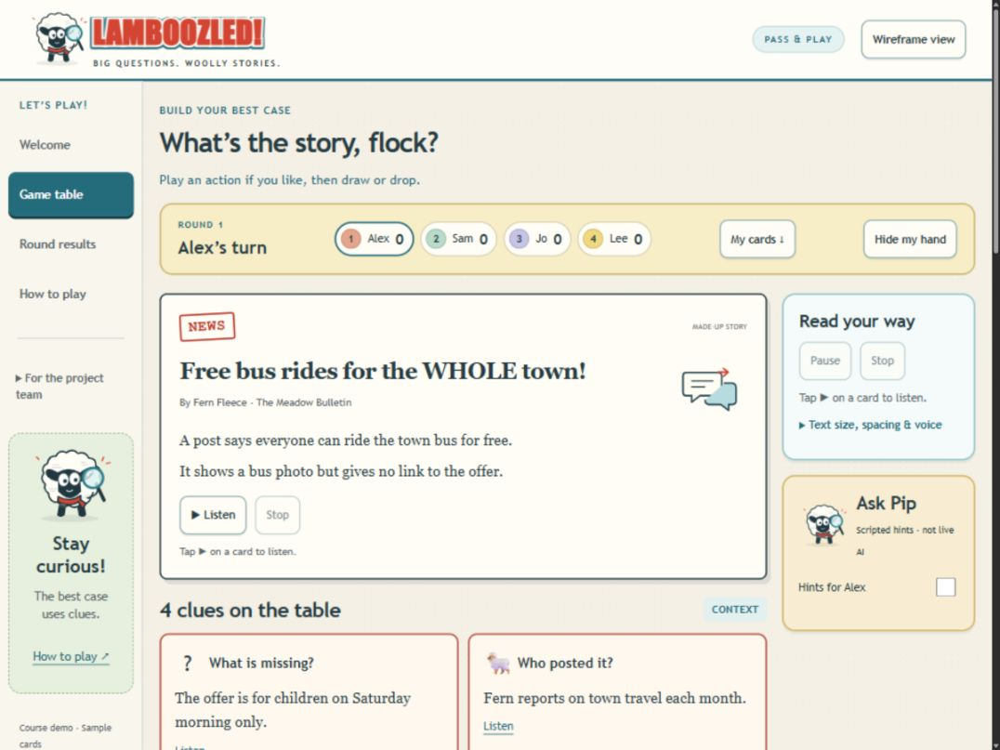

# LAMBOOZLED! - Group course project

A kid-friendly, playable news-literacy demo for **2-6 players sharing one device**, with a wireframe and four-person project handoff.

**[Play the demo](https://lamboozled-course-studio.eku2101.chatgpt.site/#lobby)** | **[Open the online wireframe](https://lamboozled-course-studio.eku2101.chatgpt.site/wireframe)** | **[Download the two-page wireframe](docs/Lamboozled-Group-Wireframe.pdf)**

The demo and online wireframe are publicly accessible without downloading the code. The demo is local pass-and-play, not a remote multiplayer room.



## Try or edit it locally

Download or clone this repository. Open `dist/index.html` for a quick preview, or use Node.js to run the local server:

```sh
node serve.mjs
```

Then open **http://127.0.0.1:4173**. No package installation, API key, or build is needed for the game. A local server is preferable for browser speech features.

The files in `dist/` are editable source. There is no build step.

## What is included

- Turns, private handovers, five-card hands, drawing, and three labeled sample action cards.
- A drop that requires every player to submit a Real or Fake evidence case.
- Evidence review, round scoring, ties, and matches ending at the selected demo target.
- Read-aloud with synchronized highlighting; text size, font, spacing, contrast, and speed settings.
- Optional, editable speech-to-text responses with a typing fallback.
- An optional scripted guide and reflection on assistance; no live AI calls.
- A wireframe, module assignment board, email draft, editable handout generator, and tests.

## Four-person starting split

Choose owners together. These are suggestions, not assignments.

| Member | Modules | Responsibilities |
| --- | --- | --- |
| A | M01 + M07 | Setup, turns, game engine, drop, scores, match results, reflection |
| B | M02 + M03 | News/context cards, decks, evidence, private hands, sample actions |
| C | M04 + M05 | Reading tools, highlighting, keyboard access, typed/spoken responses |
| D | M06 + M08 | Guide, team/content records, shared layout, integration and QA |

Each member contributes their modules, acceptance checks, and a short handoff note. Everyone helps test. Rebalance the split if needed.

## Find your part

| Location | What it contains |
| --- | --- |
| `dist/modules/` | Eight numbered UI modules |
| `dist/game-engine.js` | Turn, drop, action and scoring rules |
| `dist/cards.js` | Original sample stories, clues, and action definitions |
| `dist/core.js`, `dist/app.js` | Shared events, navigation and hand privacy |
| `dist/styles.css`, `dist/playful.css`, `dist/game.css` | Layout and child-friendly appearance |
| `dist/assets/` | Original sheep and clue illustrations |
| `dist/wireframe.html` | Self-contained printable wireframe |
| `docs/Lamboozled-Group-Wireframe.pdf` | Two-page group handout and meeting agenda |
| `docs/group-email.txt` | Copyable email inviting feedback and meeting availability |
| `docs/IMPLEMENTATION.md` | Rules, architecture, data handling, and integration details |
| `docs/previews/` | Current game preview and earlier design previews |
| `tools/make_group_wireframe.py` | Editable source for the PDF handout |

## Check your changes

```sh
node check.mjs
node --test test-game.mjs
```

The 15 rule tests cover dealing for 2-6 players, sample actions, card conservation, forced drops, contextual evidence, invalid selections, score-once behavior, ties, match endings, empty decks, and full seeded matches. Test speech features on the group's actual devices as browser support varies.

## Work together

Review [CONTRIBUTING.md](CONTRIBUTING.md) before editing shared files. Discuss the demo, suggest changes, agree on module owners, then choose a small first milestone. The existing preview is a starting point for the team's work.

To regenerate the optional PDF handout, install the Python packages in `requirements-docs.txt` and run:

```sh
python tools/make_group_wireframe.py
```

The PDF is already included; Python is not needed to play or edit the game.

## Original game and course adaptations

This is an independent student concept based on the supplied LAMBOOZLED! rule-card reference. It implements the supplied setup, turn choices, shared drop, evidence values, and round ties. The news, context, evidence, action text, and artwork in this repository are original sample content.

The user approved labeled sample actions. First to 3 or 5 round wins, rotating first players, fresh decks each round, empty-case handling, and the group review interface are documented demo choices. See [implementation notes](docs/IMPLEMENTATION.md) for the details.

The original game is credited to Ioana Literat, Yoo Kyung Chang, and the Media and Social Change Lab at Teachers College, Columbia University, and published by Teachers College Press. This repository does not imply publisher endorsement or grant rights to the official deck, rulebook wording, logo, or illustrations. Publisher reference images and uploaded rule-card photographs are not distributed here. Public repository visibility does not establish a license for official game content.
